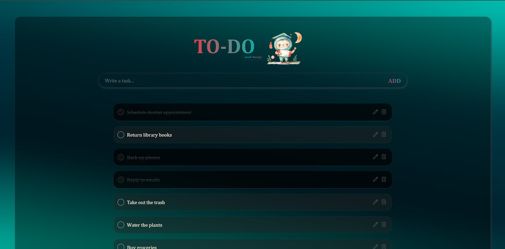
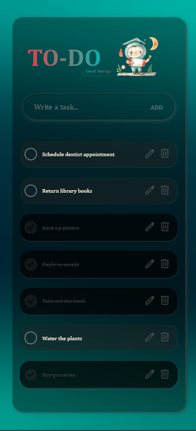

# Local To-Do List

A to-do list app built with vanilla JavaScript. Tasks are saved in the browser with `localStorage`, so there is no account or server.

**Live demo:** https://fixedbits.github.io/local-to-do-list/





## Features

- Add tasks with a form
- Mark tasks as completed with a custom checkbox
- Edit tasks with a prompt
- Delete tasks with a confirmation prompt
- Tasks persist after a page refresh using `localStorage`

## Tech Stack

- HTML5
- CSS3
- JavaScript
- `localStorage` API

## Run Locally

1. Clone the repository:

```
git clone https://github.com/FixedBits/local-to-do-list.git
```

2. Open the folder in VS Code
3. Open index.html with Live Server

## Notes

Data is stored in your browser only. Clearing your browser data or switching devices resets the task list.

## Planned

- Inline task editing
- Custom delete confirmation dialog
- Download the task list as a .txt file

## License

[MIT License](LICENSE)
